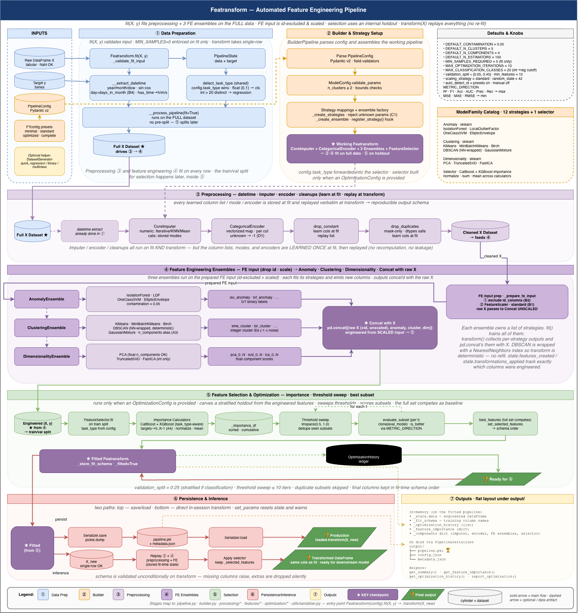

[![LinkedIn][linkedin-shield]][linkedin-url]
[![Contributors][contributors-shield]][contributors-url]
[![Stargazers][stars-shield]][stars-url]
[![MIT License][license-shield]][license-url]
[![Downloads][downloads-shield]][downloads-url]
[![Month Downloads][downloads-month-shield]][downloads-month-url]

[contributors-shield]: https://img.shields.io/github/contributors/TsLu1s/Featransform.svg?style=for-the-badge&logo=github&logoColor=white
[contributors-url]: https://github.com/TsLu1s/Featransform/graphs/contributors
[stars-shield]: https://img.shields.io/github/stars/TsLu1s/Featransform.svg?style=for-the-badge&logo=github&logoColor=white
[stars-url]: https://github.com/TsLu1s/Featransform/stargazers
[license-shield]: https://img.shields.io/github/license/TsLu1s/Featransform.svg?style=for-the-badge&logo=opensource&logoColor=white
[license-url]: https://github.com/TsLu1s/Featransform/blob/main/LICENSE
[linkedin-shield]: https://img.shields.io/badge/-LinkedIn-black.svg?style=for-the-badge&logo=linkedin&colorB=555
[linkedin-url]: https://www.linkedin.com/in/luisfssantos98/
[downloads-shield]: https://static.pepy.tech/personalized-badge/featransform?period=total&units=international_system&left_color=grey&right_color=blue&left_text=Total%20Downloads
[downloads-url]: https://pepy.tech/project/featransform
[downloads-month-shield]: https://static.pepy.tech/personalized-badge/featransform?period=month&units=international_system&left_color=grey&right_color=blue&left_text=Month%20Downloads
[downloads-month-url]: https://pepy.tech/project/featransform

<br>
<p align="center">
  <h2 align="center"> Featransform: Automated Feature Engineering Framework for Supervised Machine Learning
  <br>

## What's new in 2.4.0

Version 2.4.0 is a robustness release from a fourth review: no new feature families, but the pipeline now copes with the inputs real tables contain, and every setting it accepts is one it honors. **User-visible behavior changes:**

- **Works on pandas 1.5 → 3.x again.** 2.3.0 raised `TypeError: string dtypes are not allowed` on every pandas release before 3.0 as soon as a pipeline was fitted. The supported ranges are now tested at both ends: `numpy>=1.23.5`, `pandas>=1.5.3`, `scikit-learn>=1.2.2`, `xgboost>=2.0,<4`, `catboost>=1.2.2`, Python 3.10–3.13.
- **`transform` aligns its input to the columns seen at `fit`.** Column order no longer matters, extra columns are ignored, and a missing column is reported by name. (Reordered or extra columns used to crash inside scikit-learn whenever a clustering or dimensionality model was configured.)
- **Calling `fit` again refits everything.** A second `fit` previously kept the first dataset's imputer, encoder, scaler and models, and appended to the optimization history.
- **A fitted pipeline no longer carries its training data.** The training frame and target used to stay attached to the fitted object — and therefore inside every saved pickle. Only the output schema is kept now. `fit_transform` returns the frame built while fitting instead of running the pipeline twice.
- **More input shapes are accepted.** Non-string column labels (e.g. a frame built from a NumPy array), timezone-aware datetimes, timedelta columns (converted to seconds), entirely-missing numeric columns, column names containing `[`, `]` or `<`, and a target passed as a NumPy array / list. Duplicate column names are rejected with a clear message. `y` is optional when no optimization is configured.
- **The target is validated up front.** A length mismatch, missing target values, a single-valued target, a text target under `task_type="regression"`, or a metric that cannot score the task (`f1` on regression, `mse` on classification) now raise a `ValidationError` / `ConfigurationError` that says what is wrong, instead of failing deep inside CatBoost / XGBoost / scikit-learn. A class with a single row no longer breaks the selection split.
- **`n_jobs`, `random_state` and `verbose` reach every component.** `PipelineConfig.n_jobs` was ignored (every model ran on all cores), the imputer always used seed 42, and `verbose=True` printed nothing unless the application had configured logging. `verbose=True` now prints progress to the console on its own and still defers to your logging configuration when there is one.
- **KNN imputation runs in standardized space, and identifier columns are not imputation predictors.** Neighbours used to be chosen almost entirely by whichever column had the largest range — typically the id — which made KNN imputation barely better than the column mean.
- **DBSCAN defaults to `eps="auto"`.** The former fixed `eps=0.5` labelled every row as noise on standardized data with more than a handful of columns, producing a constant feature. The radius is now derived from the data (k-distance heuristic); pass a number to pin it. New rows join a cluster only when they lie within `eps` of one of its core samples and are noise (`-1`) otherwise.
- **Constant engineered features are dropped** (when `drop_constant` is on) and **engineered names never collide with your columns** — a clash is renamed with an `_ft` suffix (`pca_0` → `pca_0_ft`).
- **Imputation writes only the missing cells.** Complete columns keep their dtype, so integer columns (ids, label codes) are no longer converted to float.
- **Unknown configuration fields are rejected** (`ProcessingConfig(scaling="robust")` used to be silently ignored), and values assigned to a config after construction are validated.
- **`SelectionStrategy.CORRELATION` / `VARIANCE` / `RECURSIVE` warn** that they are not implemented and fall back to `IMPORTANCE`, instead of silently running it.
- **`get_summary()`** reports the real number of input columns under `features.initial` (it used to repeat the final count) and adds `engineered_selected`, `task_type`, `id_columns`, `optimization.metric` and `version`.
- **No more `catboost_info/` directory** in your working directory, and `make_dataset` no longer reseeds NumPy's global random generator.
- **Pipelines saved with 2.3.0 still load and transform**; `PipelineSerializer.load` warns when the file was fitted by a different version and refuses files that do not hold a pipeline.

## What's new in 2.3.0

Version 2.3.0 adds feature-quality improvements and tightens the configuration surface. **User-visible behavior changes:**

- **Scaling is applied to the feature-engineering input by default.** The copy fed to the anomaly / clustering / dimensionality ensembles is now standardized (`StandardScaler`) so scale-sensitive methods (PCA, KMeans, DBSCAN, One-Class SVM, LOF, …) are no longer dominated by whichever raw column has the largest magnitude. The **passthrough original columns keep their native scale** — only the transformers see scaled values. Opt out with `ProcessingConfig(scaling_strategy=None)`, or pick `robust` / `minmax`.
- **Identifier / index columns are kept out of feature engineering.** Set `ProcessingConfig(id_columns=[...])` to exclude columns explicitly; they still pass through to the output but never feed scaling or the ensembles. The preset configurations (`minimal`/`standard`/`optimized`/`complete`) additionally enable `auto_detect_id`, which excludes integer-valued, fully-unique columns (the classic id signature, order-independent). Manual configs keep `auto_detect_id=False` by default.
- **Unknown model parameters now fail fast.** A `ModelConfig(parameters=...)` key the target strategy doesn't accept raises `ConfigurationError` naming the bad key and the accepted parameters, instead of being silently dropped.
- **`GaussianMixture` honors `n_components`.** It is accepted as an alias for the strategy-level `n_clusters`, so the passed value is used rather than silently falling back to the default cluster count.
- **Classification targets are always label-encoded internally.** Numeric-but-not-contiguous class labels (e.g. `{1, 2, 3}` or `{10, 20, 30}`) no longer break XGBoost-based importance or subset evaluation.
- **Day-of-month cyclic features are normalized by the actual month length.** 28/29/30/31-day months each close the cycle correctly instead of distorting against a fixed 31.
- **`get_feature_names()` matches the columns actually emitted** by each ensemble.
- **Dataset generator:** short task aliases (`"binary"`, `"multiclass"`) are accepted alongside the canonical names, and the `medium` / `complex` synthetic datasets now emit datetime columns.
- **Packaging:** project metadata moved to `pyproject.toml` (PEP 621); `setup.py` removed; the `xgboost` pin was loosened from `==2.0.3` to `>=2.0,<3`.

## What's new in 2.2.0

Version 2.2.0 is a correctness follow-up to the 2.1.0 refactor, from a second critical review. **User-visible behavior changes:**

- **Task type is resolved from a single source of truth.** The importance calculators (CatBoost / XGBoost) now use the same resolved `task_type` as the evaluator instead of independently re-deriving it — a regression target no longer gets ranked with a classifier while being scored with a regressor.
- **Integer regression targets are detected as regression.** An integer target with more than `MAX_CLASSIFICATION_CLASSES` (default 20) distinct values is treated as regression; smaller integer sets stay multiclass. Set `task_type` explicitly to override the heuristic.
- **Transformers are fit on the full dataset.** When optimization is configured, the validation split now governs *feature selection only*; anomaly / clustering / dimensionality / processing components are fit on all rows instead of the ~75% train split (which was previously discarded).
- **Reported "best" matches the applied selection.** The full feature set now competes inside the optimizer, so `get_summary()` / `report_optimization()` can no longer advertise a score/feature-count that differs from what the pipeline actually applied.
- **Cumulative-importance threshold at 1.0 keeps every feature.** A floating-point rounding edge that could silently drop the last feature is fixed.
- **PCA component fallback is clamped to the data budget.** Requesting more components than the data allows no longer crashes; the fallback is clamped instead of using a fixed default that could itself be too large.
- **Same-family feature strategies get unique column names.** Two strategies of the same family (e.g. two KMeans) no longer emit colliding column labels.
- **Selected output columns keep the input/engineered schema order.** After feature selection the transformed frame's columns follow their original position in the schema (not importance rank). Ordering is anchored on column position, so it works for any column names — no numeric index is parsed from the name.

## What's new in 2.1.0

Version 2.1.0 ships a considerable refactor that fixes correctness, robustness, and ergonomics issues. **User-visible behavior changes** worth knowing about:

- **Schema validation is unconditional on `transform`.** A pipeline that produces extra columns at inference time gets a friendly log; a pipeline missing columns from the training schema raises a clear error. (Previously this check ran only when a feature selector was attached.)
- **`drop_constant` and `drop_duplicates` now learn at fit and replay at transform.** Output schema is reproducible across calls. The `drop_duplicates` implementation no longer corrupts column dtypes (it previously transposed the DataFrame).
- **`DEFAULT_CONTAMINATION` raised from `0.002` → `0.05`.** The previous default flagged essentially nothing as anomalous; outputs were dropped by `drop_constant` immediately. The new default matches sklearn convention.
- **Optimization metrics report natural orientation.** MSE / MAE / RMSE are non-negative; R²/F1/Accuracy/etc. unchanged. A `METRIC_DIRECTION` map drives `is_better` and "best score" selection. (Previously losses were stored as `-MSE` and unflipped at display time.)
- **Threshold sweep in feature optimization covers `[0.5, 1.0]` instead of `[0.91, 1.0]`.** Iterations explore meaningful subsets; identical subsets are deduplicated.
- **DBSCAN no longer refits at transform.** Cluster labels are assigned via a `NearestNeighbors` lookup against the training fit, making transforms deterministic.
- **`config.task_type` is honored.** Float-binary targets (0.0/1.0) are correctly identified as classification, not regression.
- **`set_params(config=...)` on a fitted pipeline resets fitted state and emits a `UserWarning`.** A subsequent `transform` raises `NotFittedError` until you refit.
- **`transform` accepts single-row inference frames.** The 5-sample minimum applies only to `fit`.
- **`NotFittedError` accepts free-form messages.** No more ungrammatical concatenations.
- **Categorical imputation uses the fit-time mode**, not the inference-time mode (no more silent leakage).
- **`AnomalyEnsemble()` works without arguments.** A previous `AttributeError` on `include_scores` is fixed.
- **Datetime hour/minute/second columns are emitted only when actually present.** Date-only inputs no longer get spurious zero-valued time columns.
- **Module-level `logging.basicConfig` and stray `os.environ` writes were removed.** Library hygiene: configure logging in your application.

If you previously called `OptimizationConfig(...)` positionally — note that it is now a `pydantic.BaseModel`. Keyword arguments work as before; positional arguments don't.

## Framework Contextualization <a name = "ta"></a>

The `Featransform` project constitutes an objective and modern proposition to automate feature engineering framework through the integration of various approachs of input pattern recognition known in Machine Learning such as dimensionality reduction, anomaly detection, clustering approaches and datetime feature constrution. Built with advanced design patterns and a modular architecture, it seamlessly orchestrates multiple feature engineering techniques including anomaly detection, clustering, dimensionality reduction, and temporal feature extraction—all optimized through intelligent validation-driven feature selection.

In order to avoid generation of noisy data for predictive consumption, after the engineered features ensemble are concatenated with the original features, a validation-driven wrapper feature selection is implemented: features are ranked by tree-ensemble importance (CatBoost and XGBoost), progressively larger top-ranked subsets are evaluated on a held-out validation split, and only the best-scoring subset is kept, maintaining only valuable columns available for future models performance improvement purposes.

The architecture design includes three main sections, these being: data preprocessing, diverse feature engineering ensembles and optimized feature selection validation.

<p align="center">
  
</p>

This project aims at providing the following application capabilities:

* General applicability on tabular datasets: The developed feature engineering procedures are applicable on any data table associated with any Supervised ML scopes, based on input data columns to be built up on.
    
* Improvement of predictive results: The application of the `Featransform` aims at improve the predictive performance of future applied Machine Learning models through added feature construction, increased pattern recognition and optimization of existing input features.

* Continuous integration: After the train data is fitted, the created object can be saved and implemented in future data with the same structure. 
   
#### Main Development Tools <a name = "pre1"></a>

Major frameworks used to built this project: 

* [Pandas](https://pandas.pydata.org/)
* [Sklearn](https://scikit-learn.org/stable/)
* [XGBoost](https://xgboost.readthedocs.io/en/stable/)
* [CatBoost](https://catboost.ai/)
* [Pydantic](https://docs.pydantic.dev/)
    
## Where to get it <a name = "ta"></a>
    
Binary installer for the latest released version is available at the Python Package Index [(PyPI)](https://pypi.org/project/featransform/).   

GitHub Project Link: [https://github.com/TsLu1s/Featransform](https://github.com/TsLu1s/Featransform)

## Installation  

To install this package from Pypi repository run the following command:

```
pip install featransform
```

<!--
Maintainer note — running the test suite locally:
  pip install -e ".[dev]" && python -m pytest
(xgboost 2.0.x needs the OpenMP runtime; on macOS install it with `brew install libomp`
 and, if it is not found, prefix the command with DYLD_LIBRARY_PATH=/opt/homebrew/opt/libomp/lib.)
-->

# Usage Example
    
## Featransform - Automated Feature Engineering Pipeline

In order to be able to apply the automated feature engineering `featransform` pipeline you need first to import the package. 
The following needed step is to load a dataset and define your to be predicted target column name into the variable `target`.
You can customize the pipeline by selecting from preset configurations (`minimal`, `standard`, `optimized`, `complete`) and specifying the task type (`regression`, `binary_classification`, `multiclass_classification`).

```py

import pandas as pd
from sklearn.model_selection import train_test_split
from featransform.pipeline import Featransform
from featransform.configs.baseline import FTconfig
from featransform.utils.serializer import PipelineSerializer
from featransform.utils.data_generator import make_dataset
import warnings
warnings.filterwarnings("ignore", category=Warning)

# Generate a sample dataset — for demonstration only.
# When using Featransform for real, swap this for your own data (X) and target (y).
X, y = make_dataset(task='multiclass_classification', n_samples=5000, complexity='medium', n_classes=3)

X_train, X_test, y_train, y_test = train_test_split(X, y, test_size=0.2, random_state=42)

# Create pipeline with preset configuration
config = FTconfig.complete(task_type="multiclass_classification")
# Available presets: minimal(), standard(), optimized(), complete()
# Task types: "regression", "binary_classification", "multiclass_classification"

pipeline = Featransform(config)

# Fit and transform
pipeline.fit(X_train, y_train)
X_train_transformed = pipeline.transform(X_train)
X_test_transformed = pipeline.transform(X_test)

# View optimization results
pipeline.report_optimization()

# Save & Load Pipeline
serializer = PipelineSerializer()
serializer.save(pipeline, 'fitted_pipeline.pkl')

loaded_pipeline = serializer.load('fitted_pipeline.pkl')
X_loaded_transform = loaded_pipeline.transform(X_test)

``` 

## Usage Examples

Further automated and customizable feature engineering applications:

* [Baseline Example](https://github.com/TsLu1s/featransform/blob/main/examples/baseline_featransform.py) - Get started with intuitive preset configurations, synthetic dataset generation, and clear pipeline serialization for production deployment
* [Advanced Configuration](https://github.com/TsLu1s/featransform/blob/main/examples/automated_featransform.py) - Build fully customized pipelines from scratch with complete control over preprocessing strategies, feature engineering components, and optimization parameters
* [Component Testing](https://github.com/TsLu1s/featransform/blob/main/examples/decomposed_featransform.py) - Deeper dive into individual components with comprehensive train-test evaluation across encoding, imputation, anomaly detection, clustering, and dimensionality reduction methods

**Prefer interactive notebooks?** Check out the [notebook examples](https://github.com/TsLu1s/featransform/blob/main/examples/notebooks) with step-by-step execution.

## Core Capabilities

**Feature Engineering Methods:**
- Anomaly Detection (Isolation Forest, LOF, One-Class SVM, Elliptic Envelope)
- Clustering (KMeans, MiniBatchKMeans, Birch, DBSCAN, Gaussian Mixture)
- Dimensionality Reduction (PCA, SVD, FastICA)
- Temporal Features (Cyclic encoding, datetime decomposition)

**Intelligent Processing:**
- Advanced Imputation (Mean, Median, Most Frequent, Constant, Iterative, KNN)
- Categorical Encoding (Label)
- Scaling of the feature-engineering input (Standard, Robust, MinMax)
- Identifier-column handling (explicit list or auto-detection)
- Automated Feature Selection (Importance-based, validated on a holdout)


```bibtex
@software{featransform2023,
  author = {Luis Fernando Santos},
  title = {Featransform: Automated Feature Engineering Framework for Supervised Machine Learning},
  year = {2023},
  publisher = {PyPI},
  url = {https://pypi.org/project/featransform/}
}
```

## License

Distributed under the MIT License. See [LICENSE](https://github.com/TsLu1s/featransform/blob/main/LICENSE) for more information.

## Contact 
 
[Luis Santos - LinkedIn](https://www.linkedin.com/in/luisfssantos98/)


